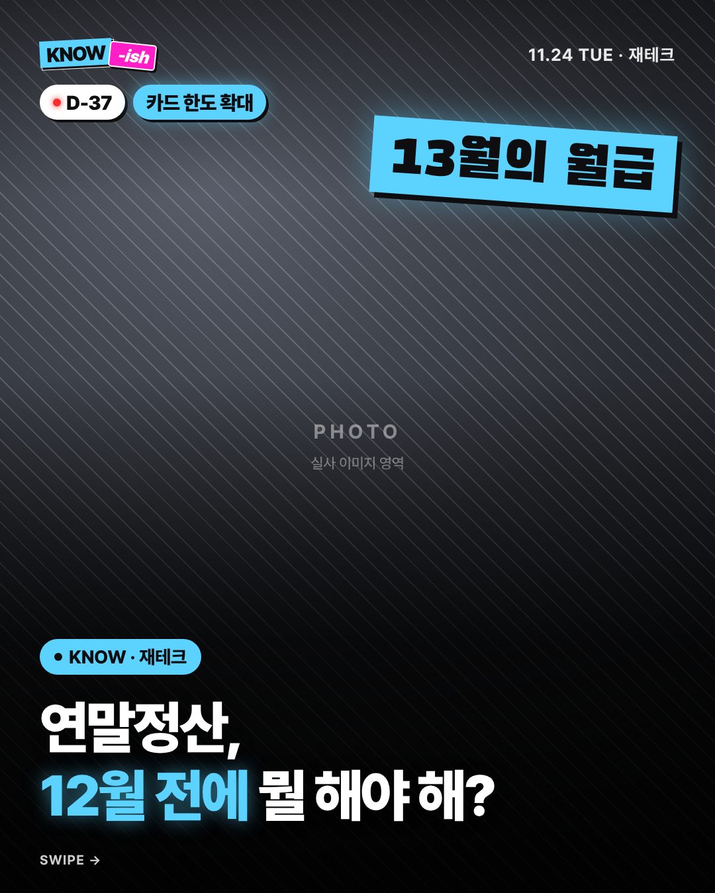
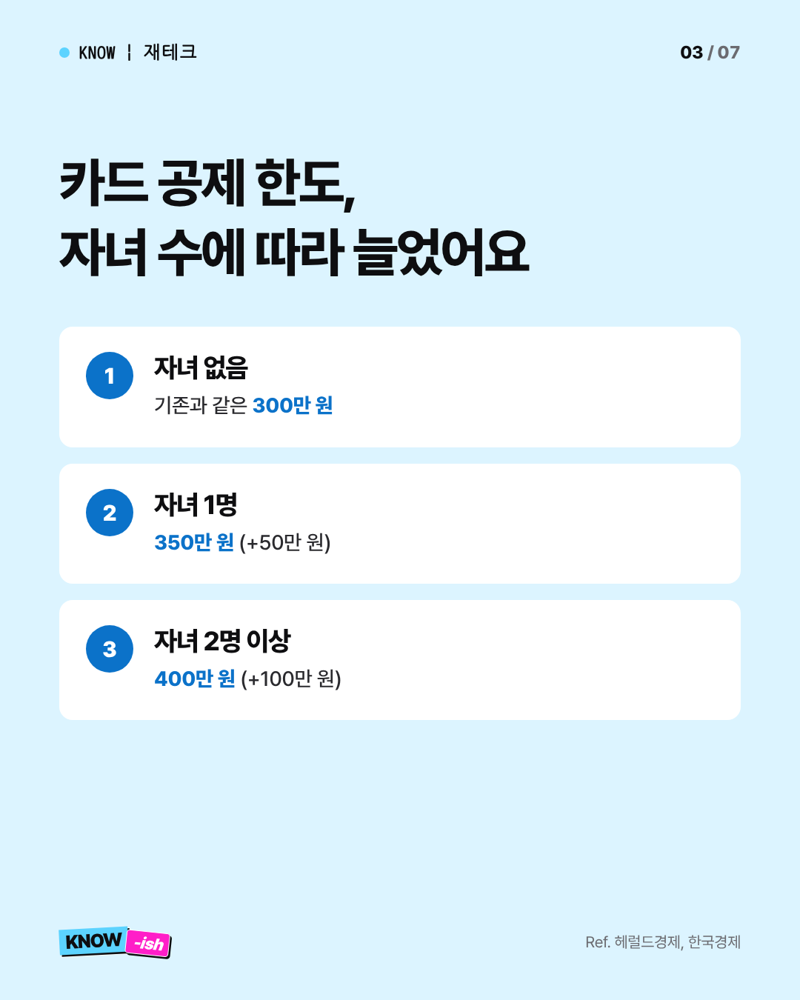
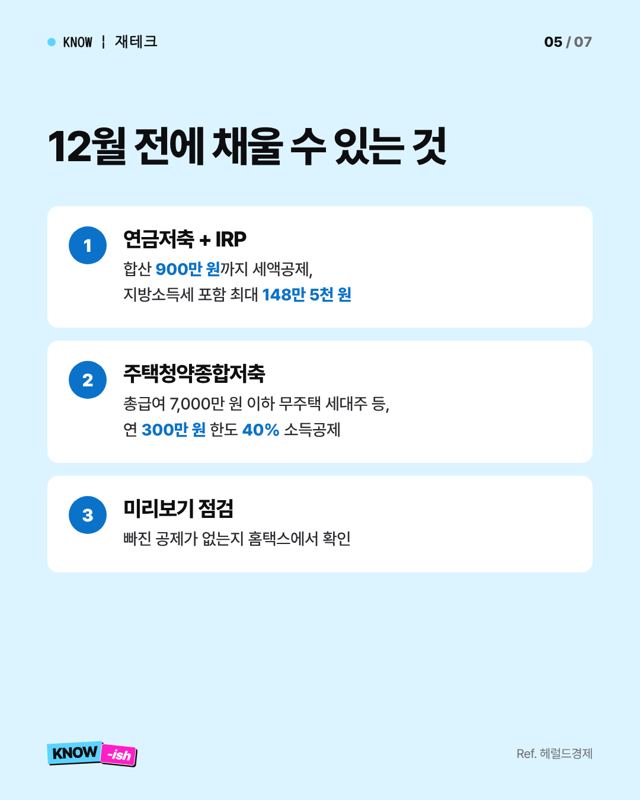

# 연말정산, 12월 전에 꼭 챙길 3가지 — 올해 달라진 카드 공제 한도까지

> 연말까지 D-37. 연말정산은 1월에 하지만 공제를 채울 수 있는 시간은 12월 31일까지입니다.
> 올해(2026년 귀속)부터 달라진 카드 소득공제 한도와, 지금 점검해야 할 항목을 정리했어요.

## 1. 먼저 홈택스 '연말정산 미리보기'부터

국세청 홈택스의 **연말정산 미리보기**는 올해 **1~9월** 카드 사용액 등을 바탕으로 예상 세액을 계산해 주는 서비스입니다(10월 28일부터 운영). 확정 환급액이 아니라, 남은 기간 어떤 공제를 더 챙길지 가늠하는 용도예요.

## 2. 카드 공제 한도, 자녀 수에 따라 늘었어요

총급여 7,000만 원 이하 근로자 기준, 2026년 사용분부터 신용카드 등 소득공제 한도가 늘어납니다(내년 초 정산에 반영).

| 자녀 수 | 공제 한도 |
|---|---|
| 없음 | 300만 원 (기존과 동일) |
| 1명 | 350만 원 (+50만 원) |
| 2명 이상 | 400만 원 (+100만 원) |

### 한도가 늘었다고 환급이 그만큼 늘진 않아요

- 공제는 **총급여의 25%를 넘게 쓴 금액**부터 시작합니다.
- 그 초과분에 **신용카드 15%, 체크카드·현금영수증 30%** 를 곱해 한도 안에서 공제됩니다.
- 재정경제부 추산(헤럴드경제 인용)으로 총급여 6,000만 원·자녀 2명이면 세 부담이 **약 15만 원** 줄어드는 정도예요.

즉, 총급여 25%를 먼저 넘겼는지가 핵심입니다. 아직 못 넘겼다면 연말까지의 지출 계획을 한 번 점검해 보세요.

## 3. 12월 전에 채울 수 있는 공제

- **연금저축 + IRP**: 합산 **900만 원**까지 세액공제(연금저축 단독은 600만 원). 지방소득세 포함 최대 **148만 5천 원**. 단, 중도 인출 계획이 있다면 신중하게 — 공제받은 세액이 환수될 수 있어요.
- **주택청약종합저축**: 총급여 7,000만 원 이하 무주택 세대주 등 요건 충족 시 연 **300만 원** 한도로 **40%** 소득공제.

## 오늘 할 일 체크리스트

1. 홈택스에서 연말정산 미리보기 열어 예상 세액·빠진 공제 확인
2. 카드 사용액이 총급여 25%를 넘겼는지 확인
3. 연금계좌·청약 납입 계획 세우기 (넣기 전 중도 인출 계획 점검)

## 한 줄 정리

> 한도보다 **25%** 부터, 12월 전에 **미리보기**부터.

---

※ 투자·가입 권유가 아닌 정보 제공용입니다. 공제 요건과 수치는 개인 상황에 따라 다르니 국세청 홈택스·안내 자료로 최종 확인하세요.

**출처**
- [헤럴드경제](https://www.heraldk.com/article/2026112120520444463) (2026.11.22)
- [한국경제](https://www.hankyung.com/article/202611135532i) (2026.11.15)
- [국세청 홈택스 연말정산](https://www.hometax.go.kr/ui/pp/yrs_index.html?isCdn=Y)

**태그**: #연말정산 #13월의월급 #카드소득공제 #연금저축 #IRP #절세 #재테크
